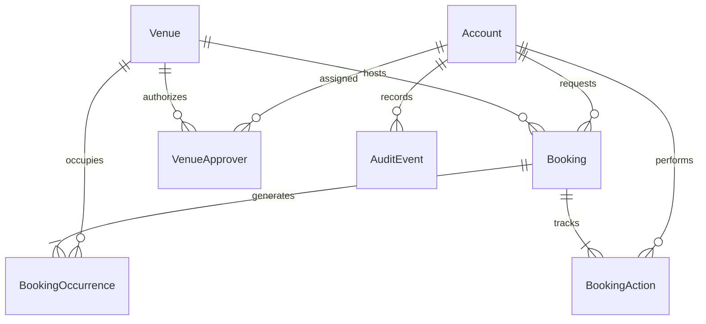

# Architecture and requirement reconciliation

`agent/PRD.md` version 2.0 is the business source of truth. `agent/agent_instructions_corrected.md` supplies the implementation structure and stack. Its legacy account-management pages, organization-wide approver access, administrator decision/cancellation powers, and demo venue seeds are superseded by PRD v2.0.

## Folder structure

```text
client/
  src/
    assets/         # Local illustration used until a venue image is verified
    components/     # Shared layout, accessible form controls and schedule preview
    context/        # In-memory AuthContext
    hooks/          # Request loading/error lifecycle
    pages/          # Route-level React screens
    services/       # Axios client and timezone display helpers
    App.jsx
    main.jsx
    index.css
server/
  src/
    config/         # Validated environment and Prisma client
    controllers/    # HTTP response adapter; no booking rules
    routes/         # Versioned endpoints, validation and role guards
    middlewares/    # Authentication, security, rate limit and safe errors
    services/       # Booking, venue and authentication rules
    validators/     # Strict Zod request schemas
    utils/          # Kolkata recurrence generation and errors
    app.js
    server.js
  prisma/
    schema.prisma
    migrations/     # Initial PostgreSQL schema plus check constraints
    data/venues.json
    seed.js
  scripts/          # Workbook extraction and trusted account maintenance
  tests/            # Unit, real HTTP, PostgreSQL integration and browser tests
```

## Schema



- UUID identities are independent of workbook serials. Venue names and room references are deliberately not unique.
- Each booking holds its canonical event/contact fields, original local schedule, status and requester. A series has one status. Occurrences store UTC `timestamptz` instants, indexed by venue and time.
- `VenueApprover` has a composite primary key, assigned-by foreign key and timestamp. Assignment queries require a currently active APPROVER account.
- `BookingAction` records submission, decision and cancellation actors and reasons. `AuditEvent` records venue/assignment changes and trusted account maintenance without credentials.
- PostgreSQL checks enforce positive capacity/guest count, valid opening configuration, ordered occurrence times and normalized account emails. An additional composite foreign key prevents occurrence/booking venue mismatches.
- No endpoint deletes bookings, actions, venues or accounts. Referenced records use restrictive foreign keys.

## Transaction and concurrency convention

Every slot-affecting operation acquires `SELECT id FROM "Venue" ... FOR UPDATE` inside a Prisma interactive transaction **before** reading current venue, assignment, request and conflicting occurrences. This includes create, approve/reject, cancel, venue update and assignment replacement. PostgreSQL READ COMMITTED makes the queries after a waited lock see the preceding committed write. Do not replace this with an unlocked check followed by an insert.

Conflicts use half-open intervals: `candidate.start < occupied.end && candidate.end > occupied.start`, considering both PENDING and APPROVED. Adjacent events are valid. Every occurrence is validated before a nested series creation; a failure rolls back everything. Decisions exclude their own holds and recheck status after acquiring the lock. They do not reapply the original rolling horizon, because a submitted schedule remains valid as time advances, but the first occurrence must still be in the future.

Trusted maintenance locks all venue rows in UUID order before updating accounts. It increments `tokenVersion` when updating an account. Future maintenance or database integrations must preserve this locking convention; direct SQL writes to reservations outside it are unsupported.

## Authorization and privacy

Roles are independent. REQUESTER owns requests; APPROVER sees requests for current assignments; ADMIN handles venue configuration and assignments. Admins see operational intervals through the calendar, with no contact, purpose, guest count or event details. Shared calendar and availability responses expose times, venue and status only (with an owner's booking link in their own calendar).

JWTs expire after two hours and stay in browser memory. Refreshing requires login. Every authenticated request loads current role, active status and token version from PostgreSQL. Each protected mutation rechecks the actor in the transaction. Self-decisions remain forbidden after role changes. Account provisioning/role changes have no public API.

## Catalog provenance

The checked-in fixture is extracted from `coep_venues.xlsx`, sheet `in`, rows 2–62. It preserves 61 serials (50 absent), raw cell values, source labels and hyperlink targets including query strings. Six capacities remain null. All original venues start active but with bookings disabled and no assumed opening hours or verified display images. Re-seeding inserts missing serials without overwriting admin edits. Raw review notes remain provenance notes even after an administrator verifies the current configuration.

## Frontend

One reusable navbar derives links from centralized role configuration; route guards complement server enforcement. Dashboard, catalog, details, availability, calendar and profile are shared. Requester, approver and administrator pages are guarded separately. Profile and venue editing use native modal dialogs. Calendar is loaded on demand. It displays IST wall-clock values in FullCalendar UTC mode to avoid relying on the browser timezone or introducing another timezone plugin. API timestamps remain UTC.

No public registration, account management screen, automatic hold expiry, email delivery, partial series editing or priority overrides are implemented.
